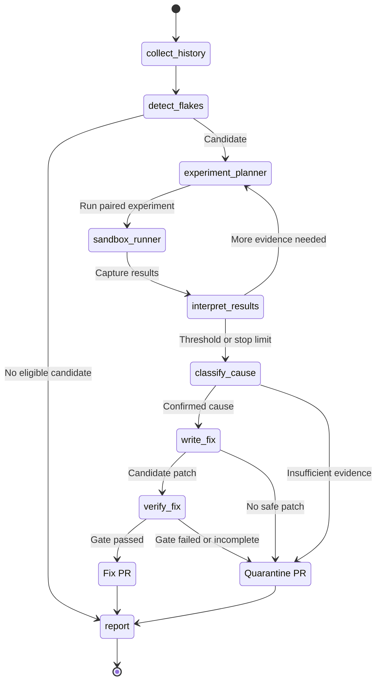

# FlakeHunter plan

## TL;DR

- **PLAN** Diagnose flaky pytest tests from GitHub Actions history and produce evidence for maintainers.
- **PLAN** Week 1 takes one synthetic flake from history through rules-only diagnosis to a report, without Docker, an LLM, or PRs.
- **PLAN** v1 ships network-isolated Docker, a 50-run stress gate, draft fix and quarantine PRs, and dry-run reports. Only the PR step receives the write token.
- **PLAN** v1.1 adds receipt digests, a separate trusted publisher job, image pinning, and a full patch-policy checker.
- **PLAN** Reproduce at least two real open-source flakes separately from the synthetic benchmark and compare two coder models on the 8 GB laptop.

**VERIFIED** marks repository facts and sourced observations. **ASSUMPTION** marks hypotheses, estimates, and proposed thresholds. **PLAN** marks intended work and acceptance criteria. Planned artifacts and results require evidence before they count as delivered.

## 1. Problem and evidence

| Status | Claim |
| --- | --- |
| VERIFIED | A five-year industrial case study found that flaky-test work consumed at least 2.5% of productive developer time in the project studied. [Leinen et al., ICST 2024](https://mediatum.ub.tum.de/doc/1730194/1730194.pdf) |
| VERIFIED | The same study estimated $5.67 in developer time per manually investigated pipeline failure and about 0.02 cents in compute per automatic test rerun (Section IV-A). The introduction gives $0.02 for the rerun, which differs from the abstract and detailed calculation. [Leinen et al., ICST 2024](https://mediatum.ub.tum.de/doc/1730194/1730194.pdf) |
| VERIFIED | In Eck et al.'s 2019 survey, 92 developers (77%) described flaky tests as time-consuming because the failure is difficult to reproduce and reproduction is uncertain. [Eck et al., ESEC/FSE 2019, Section 4](https://arxiv.org/pdf/1907.01466#page=7) |
| VERIFIED | Flakes consume developer and CI time and make it harder to trust regression results. Google reports rerunning failures and quarantining tests. It also describes how retries can encourage teams to ignore flakes and how quarantine can hide real failures. [Google Testing Blog](https://testing.googleblog.com/2016/05/flaky-tests-at-google-and-how-we.html) · [Python flakiness study](https://arxiv.org/abs/2101.09077) |
| VERIFIED | Trunk Flaky Tests documents detection, quarantine, failure context, and an auto-fix beta on its roadmap. Trunk has also described a prior agent that opened fix PRs. [Trunk overview](https://github.com/trunk-io/docs/blob/main/flaky-tests/overview.md) · [Trunk roadmap](https://trunk.io/roadmap) · [Trunk engineering write-up](https://trunk.io/blog/don-t-build-agents-build-context-enrichment) |
| VERIFIED | BuildPulse documents detection and quarantine and lists root-cause analysis among its capabilities. `pytest-rerunfailures` retries failed cases with `--reruns`. [BuildPulse detection](https://buildpulse.io/docs/flaky-tests) · [BuildPulse documentation](https://docs.buildpulse.io/) · [pytest-rerunfailures](https://github.com/pytest-dev/pytest-rerunfailures) |
| ASSUMPTION | Python maintainers and CI owners using GitHub Actions will value a reviewable diagnosis and fix enough to adopt the tool. Validate with two maintainers who currently rerun or skip flaky tests. Ask each to compare the evidence and time needed for a recent incident. |
| PLAN | Fill the gap between a flaky-test signal and a merge-reviewable fix for pytest on GitHub Actions. Diagnose the cause with controlled experiments, open a fix PR only after a reproducible before-and-after verification gate, and attach the commands, counts, and logs. A quarantine PR records unresolved evidence and ownership. The originality claim is this specific workflow and its auditable gate. Market uniqueness is unverified. |

## 2. Scope and success metrics

**PLAN.** v1 targets Python 3.12, pytest, and GitHub Actions jobs with retained per-test JUnit artifacts. Cover history ingestion, candidate detection, diagnosis, verification, and PR delivery. Exclude other languages, test frameworks, CI providers, arbitrary log scraping, cross-repo investigations, and automatic merge. Concurrency is stretch.

| Release (PLAN) | Deliverables |
| --- | --- |
| v1 · Must ship | A 50-run stress gate, a Docker runner using `--network=none`, draft fix and quarantine PRs, and a dry-run report. Only the PR step receives the publish token. |
| v1.1 | Receipt digests for candidate and evidence integrity, a separate trusted publisher job, sandbox image pinning, and a full patch-policy checker. |

| Target (ASSUMPTION until measured) | Measurement |
| --- | --- |
| Root-cause accuracy ≥70% | At least 7 of 10 flaky cases have the correct primary label. Unknown, missed, and timed-out cases count as incorrect. |
| Zero stable controls flagged | 0 of 10 stable controls reported as flaky or given a cause or PR. |
| Zero fix PRs bypassing or failing verification | Audit every published fix PR against its runner evidence. Require at least one verified fix PR in the demo and exercise a rejection that reaches the quarantine path. Record any later CI failure separately. |
| Reproduce ≥2 real flaky tests from open-source repos | Record each upstream repo, revision, test node ID, replay command, matching failure, and passing control. Report these results separately from the synthetic benchmark. |
| Investigation <10 min per flaky test on the reference laptop | Report every elapsed time and the maximum across the 10 cases. Time from candidate selection through classification or abstention, with the sandbox image and model weights cached. Report cold setup and patch verification times separately. |

## 3. Root-cause taxonomy

**VERIFIED tooling.** The upstream tools document the flags and time control APIs below. The runner-owned `flakehunter_probe` plugin and its `FH_*` inputs are **PLAN** interfaces. [pytest-randomly](https://github.com/pytest-dev/pytest-randomly) · [pytest-repeat](https://github.com/pytest-dev/pytest-repeat/blob/main/README.rst) · [freezegun](https://github.com/spulec/freezegun) · [pytest-socket](https://github.com/miketheman/pytest-socket/blob/main/README.md)

**ASSUMPTION to test.** Each symptom suggests a cause. Confirmation requires a repeated match to the historical failure signature and a passing matched control. Commands run inside the Linux sandbox. `$TARGET`, `$PREDECESSOR`, `$MODULE`, and `$SEED` stand for the target node ID, predecessor node ID, module path, and recorded seed.

| Cause | Symptom | Experiment (PLAN) | Confirm when | Typical safe fix | Risky fix to avoid |
| --- | --- | --- | --- | --- | --- |
| Order dependence | Passes alone, fails after a neighbor | `pytest "$MODULE" --randomly-seed="$SEED" --randomly-dont-reset-seed` with a small seed set. Replay `pytest -p no:randomly "$PREDECESSOR" "$TARGET"` and the target alone, confirming actual execution order. | A minimized predecessor sequence recreates the failure and removing or reversing it restores the pass. | Give each test explicit setup and teardown. | Enforce a fixed suite order. |
| Shared state | Later iterations fail after fixture, cache, or data accumulation | `pytest -p no:randomly "$TARGET" --count=20 --repeat-scope=function` versus 20 fresh `pytest -p no:randomly "$TARGET"` invocations. Repeat with the suspected fixture or resource reset. | The identified state drifts before failure and resetting it removes the failure under the same sequence. | Isolate temp paths, transactions, caches, or fixture instances. | Clear unrelated global state or serialize the entire suite. |
| Timing / sleep | A readiness check fails under delay | `FH_READY_DELAY_MS=0 pytest -p flakehunter_probe "$TARGET"` versus the same command with `FH_READY_DELAY_MS=250`. The harness controls the identified readiness boundary. | Failure tracks readiness relative to the assertion and a deterministic readiness signal removes it. | Await a completion signal with a bounded timeout. | Add a longer sleep or blanket retry. |
| Clock / timezone | Fails around rollover, expiry, or timezone conversion | `TZ=UTC FH_FREEZE_AT=2026-01-01T23:59:59Z pytest -p flakehunter_probe "$TARGET"`. Repeat with `2026-01-02T00:00:01Z` or change only `TZ` to `America/New_York`. The probe wraps the relevant fixture or call in `freezegun.freeze_time()`. | Crossing the boundary reproduces the same failure while the nearby control passes. Check named-zone behavior with tzdata and keep real event-loop time where needed. | Inject a clock and use timezone-aware datetimes. | Hard-code local offsets or freeze a clock across unrelated tests. |
| Randomness / seed | Assertion fails only for certain generated values | `pytest "$TARGET" --randomly-dont-reorganize --randomly-seed="$SEED"` for recorded passing and failing seeds. Capture generated inputs or explicitly seed an independent generator through the probe. | The bad seed or captured input reproduces the signature with order fixed and a matched good input passes. | Use explicit inputs for regression cases and seed generators locally when randomness is relevant. | Mask invalid inputs by picking a lucky seed. |
| Network | External call times out or returns inconsistent data | Locate socket use with `pytest "$TARGET" --disable-socket`. Replay `FH_STUB_MODE=ok pytest -p flakehunter_probe --allow-hosts=127.0.0.1 "$TARGET"` and repeat with `FH_STUB_MODE=timeout` or `error`. Keep the same loopback endpoint. | Stub fault recreates the historical signature and the healthy response passes. A socket-blocking error alone identifies socket use. | Inject a client and test controlled responses and timeouts. | Hit production, allow internet access, or swallow network errors. |
| Concurrency (stretch) | A failure tracks a worker interleaving | `FH_INTERLEAVING=overlap pytest -p flakehunter_probe "$TARGET"` versus `FH_INTERLEAVING=serial`. Use barriers at the suspected read/write boundary. | A specific interleaving recreates the failure and a synchronized control passes. | Use synchronization or per-worker ownership. | Add sleeps or disable parallelism globally. |

## 4. LangGraph state machine

**VERIFIED.** LangGraph supports typed state and conditional transitions. GitHub exposes retained Actions artifacts via REST. [LangGraph Graph API](https://docs.langchain.com/oss/python/langgraph/graph-api) · [GitHub Actions artifacts API](https://docs.github.com/en/rest/actions/artifacts)

**PLAN.** Collect JUnit artifacts and job metadata, keyed by repository, head SHA, workflow/job, normalized matrix and environment fingerprint, run ID, and attempt. Group by comparable environment and full pytest node ID. A pass and fail on the same SHA in distinct attempts identify a candidate. Deduplicate uploads and report missing metadata or expired artifacts as insufficient history. Create one investigation state per candidate.

### Pydantic state schema (PLAN)

Use `InvestigationState(BaseModel)` with the fields below. Nested records also derive from `BaseModel`. Use empty lists for unpopulated collections and `None` for unassigned optional fields.

| Fields | Python type | Purpose |
| --- | --- | --- |
| `repo`, `head_sha`, `correlation_id` | `str` each | Identify the repository, immutable checkout, and run. |
| `history` | `list[HistoryRow]` | Comparable observations and source links. |
| `node_id` | `str \| None` | Parametrized pytest node ID selected for investigation. |
| `failure_signature` | `str \| None` | Exception class, check or stable assertion fingerprint, and test phase. |
| `pending` | `ExperimentSpec \| None` | Next approved experiment. |
| `results` | `list[ExperimentResult]` | Append-only experiment evidence. |
| `experiment_count` | `int` | Starts at 0. Increment at dispatch. Range 0–6. |
| `deadline_utc` | `AwareDatetime` | Persisted investigation deadline. Enforce elapsed time with a monotonic clock. |
| `cause` | `Cause \| None` | Enum of the seven taxonomy labels plus `unknown`. |
| `confidence` | `float` | Rule-derived score in [0, 1], initially 0. |
| `stop_reason` | `StopReason \| None` | Enum for no candidate, confirmed, budget, timeout, or infrastructure error. |
| `patch_ref` | `str \| None` | Reference to the candidate patch. |
| `verification` | `VerificationResult \| None` | Runner-produced evidence for the base SHA and candidate checked in the same workflow run. |
| `outcome` | `Literal["pending", "report_only", "fix_pr", "quarantine_pr"]` | Publish result, with report-only as the dry-run or permission fallback. |
| `pr_url`, `report_ref` | `str \| None` each | Link to the draft PR and redacted evidence. |

| Nested model | Fields and types |
| --- | --- |
| `HistoryRow` | `run_id: int`, `attempt: int`, `job_key: str`, `env_key: str`, `head_sha: str`, `node_id: str`, `outcome: Literal["pass", "fail", "skip", "error"]`, `signature: str \| None`, `source_url: str` |
| `ExperimentSpec` | `id: str`, `cause: Cause`, `control: ProbeArm`, `trigger: ProbeArm`, `timeout_s: int` |
| `ProbeArm` | `argv: list[str]`, `env: dict[str, str]`, `repetitions: int`. Runner validates argv and environment against the probe allowlist. |
| `Trial` | `arm: str`, `exit_code: int \| None`, `outcome: Literal["pass", "fail", "skip", "error", "timeout"]`, `signature: str \| None`, `elapsed_s: float`, `log_ref: str` |
| `ExperimentResult` | `spec: ExperimentSpec`, `trials: list[Trial]` |
| `VerificationResult` | `base_sha: str`, `patch_ref: str`, `base_trials: list[Trial]`, `stress_trials: list[Trial]`, `suite_passed: bool`, `passed: bool`, `evidence_ref: str` |

**ASSUMPTION.** Start with a deterministic evidence score of 0.50 for a single matched failure, 0.80 for at least two matching trigger failures and two clean paired controls, and 0.95 if a targeted intervention also reverses the failure. This is a routing rule. Measure its precision before treating it as calibrated confidence.

**PLAN.** Stop on a unique leading cause scoring ≥0.80, six dispatched experiments per test, an exhausted candidate list, or a 9 min 30 sec diagnosis deadline. Cap each experiment at 90 sec or remaining time. Conflicting candidates or unconfirmed signatures yield `unknown`. Verification has a separate 10-minute initial cap. Treat incomplete runs, timeouts, and infrastructure errors as gate failures.

## 5. Trust, safety, and verification

| Rule (PLAN) | Enforcement and evidence |
| --- | --- |
| Only `verify_fix` can pass a patch | Use runner-owned test selection. First replay at least two matches to the original failure and two passing controls on the unpatched base. Predeclare the stress matrix before patch drafting. On the exact candidate, require all 50 fresh pytest processes to pass with the target executed, including 35 trigger runs and 15 controls, plus the relevant suite. Record the base SHA, candidate patch reference, conditions, and test results. Missing, skipped, xfailed, timed-out, or failed cases block fix publication. |
| Isolate v1 sandbox test execution | Use an ephemeral, non-root Docker sandbox with an allowlisted environment, prebuilt image, resource and time limits, a disposable checkout, dropped capabilities, and no host credentials or Docker socket. Use `--network=none` throughout, with a runner-owned loopback stub available only for network probes. Do not publish ports. Test egress denial and confirm the stub can be reached. [Docker none network](https://docs.docker.com/engine/network/drivers/none/) |
| Keep the publish token in the PR step | Treat repo files, logs, and model output as untrusted inputs. Use read-only permissions for history retrieval. On opted-in repositories, pass the verified candidate from the runner to the PR step in the same workflow run. Inject the scoped publish token only into that step. Keep it out of job-wide environment variables, checkout credentials, test execution, and model prompts. Write only topic branches and draft PRs. Never merge or force-push. Deduplicate by repository, base, and node ID. |
| Failed verification goes to quarantine review | Open a metadata-only quarantine PR for a detected flake with no verified fix. Include evidence, owner, expiry, and recheck instructions. Required CI still runs the test. Dry runs, unauthorized targets, or missing permissions emit the same proposal as a report. |
| Keep ground truth separate | Run diagnosis on a snapshot without `benchmark/labels.json`, answer-bearing fixture metadata, or access to the scoring job. Apply labels only in a separate scorer after predictions are frozen. Redact sensitive output before storing results or prompting a model. |

**ASSUMPTION.** Fifty passes give practical regression evidence for the selected stress conditions. Rare or environment-specific failures may escape the matrix. Measure repeatability, preserve the original coverage and test intent, and keep maintainer review in the loop.

## 6. Product model strategy

**VERIFIED.** Ollama offers local coder models. The reference laptop has an RTX 5050 with an 8 GB VRAM budget. [Ollama coder model example](https://ollama.com/library/qwen2.5-coder:7b)

**PLAN.** Benchmark two candidate coder models that fit 8 GB VRAM through Ollama behind a swappable `LLMClient`. Use the same benchmark cases, 4K context cap, request budget, and verification gate for both. Record each model identifier and configuration, peak VRAM, latency, and gate outcomes, including rejected drafts and timeouts. Compare gate pass rate across the same attempted cases first and use latency to break ties. Deterministic rules own evidence scoring, experiment selection, and verification. The model ranks hypotheses and drafts one patch per case. Use a fake client for deterministic CI.

**ASSUMPTION.** Two candidates will fit the memory budget and at least one will draft a patch that passes the gate within budget. Keep a rules-only path and publish quarantine proposals when no patch passes.

## 7. Evaluation and CI tracking

**PLAN.** Create `demo_repo` with 10 intentional flakes and 10 stable controls. Use two flakes per family across order/shared state, timing, clock/timezone, randomness, and network. Give the isolation family one order-dependence case and one direct shared-state case. Score the exact taxonomy label and report family accuracy as a secondary measure. Concurrency is outside the 20-case score.

- Replay captured GitHub Actions fixtures with comparable pass/fail attempts and include cases with expired or missing history.
- Freeze predictions before the separate scorer reads `benchmark/labels.json`. Upload per-case predictions, accuracy numerator/denominator, stable false positives, unknowns, elapsed times, PR decisions, and runner evidence. Include commit, image reference, and model/config identifier.
- Run a rules-only benchmark on PRs and nightly on the default branch. Retain versioned JSON and a Markdown job summary for trend comparison. Record the laptop model-assisted run separately with the same case IDs and scorer.

**PLAN.** Reproduce at least two real flaky tests from open-source repositories and publish their replay evidence in a separate report. Use upstream issue or CI links where available and keep these cases out of the synthetic score.

**ASSUMPTION.** The synthetic cases demonstrate the pipeline. The real cases provide an initial check on how it transfers to upstream projects.

## 8. Codex lifecycle and judge evidence

**VERIFIED.** `AGENTS.md`, the initial CI workflow, `MODEL_LOG.md`, and `EVIDENCE.md` exist. OpenAI documents skills and the `@codex review` command. **PLAN.** Organize the evidence pack by stage. For each entry record the rubric criterion, date, commit, artifact or run URL, observed result, and any limitation. [Codex skills](https://learn.chatgpt.com/docs/build-skills) · [Codex code review](https://developers.openai.com/blog/custom-code-review-rules-for-codex)

| Stage | Judge-checkable artifact or capability (PLAN unless noted) |
| --- | --- |
| Understand | Existing `AGENTS.md` plus sourced problem notes, two maintainer interviews, and an anonymized sample of CI history. |
| Plan | This plan, ADRs, issue checklists, and a linked Codex planning transcript or summary. |
| Build | Merged implementation commits and a Codex run invoking `.agents/skills/flake-investigation/SKILL.md` from the repository root. **VERIFIED:** Codex scans the root `.agents/skills/` directory for repo-local skills. Link the skill and its output. [Codex skill discovery](https://learn.chatgpt.com/docs/build-skills#where-codex-loads-local-skills) |
| Test | Existing CI checks plus benchmark run URL, scorer output, and gate evidence for a passing and rejected patch. |
| Review | Request `@codex review` on every PR. Link review comments and their dispositions or an explicit clean result. Record any unavailable reviews as missing evidence. |
| Document | README reproduction commands, a sample report, and the completed `EVIDENCE.md` with links across all stages. |
| Ship | Tag, GitHub release, PyPI package URL, and clean Python 3.12 install and CLI smoke-test log. |
| Automate | GitHub Actions delivery, scheduled nightly run URL, posted benchmark summary, and a logged repeat execution of the verification skill. |

| Rubric criterion | Points | Judge verification (PLAN) |
| --- | ---: | --- |
| Lifecycle Coverage | 30 | Follow all eight stage entries in `EVIDENCE.md` to actual artifacts. |
| Codex Capability Use | 25 | Inspect repo guidance, skill invocation, Codex PR reviews, and recorded CI or scheduled automation runs. |
| Model & Reasoning-Effort Discipline | 20 | Sample `MODEL_LOG.md` for actual settings, reasons, escalations, and outcome links. Compare rules-only and model-assisted runs. |
| Working Result & Engineering Craft | 15 | Reproduce the demo, inspect scorer output and gate evidence, and follow the install smoke test and sandbox checks. |
| Problem Worth Solving & Originality | 10 | Review cited evidence, maintainer feedback, competitor scope, and one complete chain from flaky history to verified fix PR. |

## 9. Codex model and reasoning-effort policy

**PLAN.** Use the available fast coding model for routine tasks, the default coding model for implementation, and the most capable available model for high-risk design or review. These effort tiers describe project policy. Record the model and actual setting shown by the Codex surface.

| Tier | Tasks | Reason |
| --- | --- | --- |
| Light | Copy edits, issue drafting, routine docs and formatting | Narrow diffs with direct checks. |
| Medium | JUnit parsing, CLI and graph wiring, regression tests, CI and release configuration | Requires cross-file reasoning and integration checks. |
| High | Sandbox and publisher trust boundary, verification design, ambiguous reproduction, and safety review | A mistake can expose credentials, weaken coverage, or permit an unverified PR. |

Log every Codex task in `MODEL_LOG.md` with date, task or issue, model, actual effort, reason, changes in effort, checks, and evidence link. Mark settings unavailable when hidden. Start at the lowest suitable tier and document escalation after new complexity or a failed approach.

## 10. Four-week milestones

**ASSUMPTION.** Solo capacity is 15–20 hours per week. Week 3 is the demo deadline. Issue IDs map to [issue drafts](issues.md).

| Week | Deliverables (PLAN) | Done when |
| --- | --- | --- |
| 1 · 16 h | W1-1 evidence and Day 1 environment check, W1-2 history ingestion, W1-3 first benchmark case and report | One synthetic benchmark flake goes from captured history through rules-only diagnosis to a report. The slice uses local fixtures and runs without Docker, an LLM, or PRs. |
| 2 · 19 h | W2-1 sandbox and probes, W2-2 graph and classification, W2-3 Ollama adapter, W2-4 full benchmark and scorer | All five benchmark families run under the budget in Docker with `--network=none` and produce replayable logs. The separate scorer evaluates the full 20-case corpus. Rules-only reports work with the model disabled. |
| 3 · 20 h | W3-1 verification gate, W3-2 PR delivery, W3-3 model selection and demo rehearsal | Require the 50-run gate, draft fix and quarantine PRs, and dry-run reports. Verify that only the PR step receives the publish token. Select the model after both candidates run against the same gate. |
| 4 · 16 h | W4-1 CI and nightly, W4-2 release, W4-3 evidence audit and open-source reproduction | Archive nightly scores, verify a clean package install, link evidence for each rubric row, and report at least two real open-source reproductions separately. |

## 11. Risk register

**ASSUMPTION.** Likelihood and impact are estimates. Update them with measurements after each milestone.

| Risk | Likelihood | Impact | Mitigation (PLAN) | Fallback |
| --- | --- | --- | --- | --- |
| Candidate models exceed 8 GB VRAM or write weak patches | Medium | High | Screen two models for peak VRAM, then compare gate pass rate and latency under the same limits. | Rules-only diagnosis and quarantine-only publishing. |
| Docker Desktop with WSL 2 is unavailable on Windows | Medium | High | On Day 1 confirm the WSL 2 backend and Linux containers. Run `wsl --version`, `wsl --list --verbose`, and `docker info`, then smoke-test a cached Linux image with `docker run --rm --network=none alpine ip route` and confirm there is no default route. Record the result or blocker. [Docker Desktop for Windows](https://docs.docker.com/desktop/setup/install/windows-install/) | Use a Linux runner for sandbox work. Continue the Week 1 slice with local fixtures. |
| Missing JUnit artifacts or unmatched environments | High | High | Document the artifact manifest, retain samples, and require same-SHA comparable attempts. | Report insufficient history and use recorded demo inputs. |
| Probe fails to recreate a rare flake | High | Medium | Preserve signature, order, seed, and environment. Compare matched trigger/control arms. | Abstain and propose quarantine only for a supported flake. |
| Sandbox or PR-step isolation fails | Low | High | Run egress and credential-isolation tests. Verify that only the PR step receives the publish token. | Stop execution or publication and emit a dry-run report where safe. |
| Benchmark labels leak into diagnosis | Medium | High | Separate checkout and scorer, freeze predictions, and assert excluded paths. | Invalidate the score and rerun with isolated inputs. |
| Stress gate or Docker startup misses budget | Medium | High | Cache images, keep the target set small, time each phase, and publish timeout counts. | Keep the full gate. Quarantine when verification cannot finish. |
| Week 3 slips or access to GitHub/PyPI is delayed | Medium | High | Build one vertical slice first and confirm account and repo setup in week 1. | Cut concurrency, then breadth of automated patch drafting. Record dry-run evidence and list any unshipped deliverable. |
